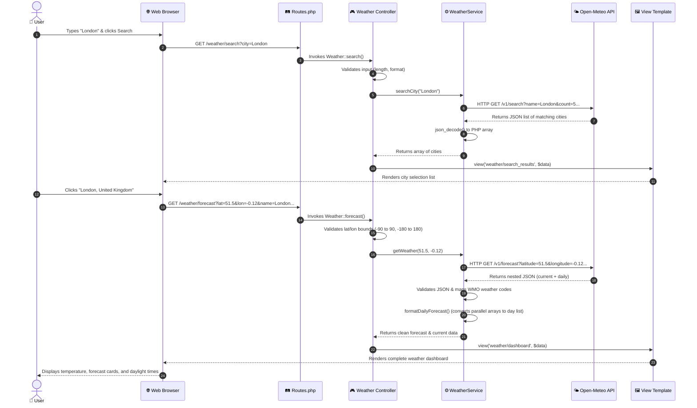

# 🌤️ Weather Application Using CodeIgniter 4 & Open-Meteo API

A modern, responsive, and robust Weather Web Application built with **PHP 8.2**, **CodeIgniter 4.7**, and the free, open **Open-Meteo REST API**.

This project demonstrates how a real-world web application communicates with external third-party APIs using a clean Model-View-Controller (MVC) and Service-Layer architecture.

---

## 📋 Features

- 🔍 **City Search & Disambiguation:** Resolves user-entered city names to multiple global matches with state, country, and coordinate badges.
- ⚡ **Popular City Quick Links:** One-click shortcuts on the landing page for major global cities (Guwahati, London, Tokyo, New York, Paris, Sydney).
- 🌡️ **Real-Time Weather Metrics:** Current temperature (°C), "Feels Like" temperature, humidity percentage, wind speed (km/h), and precipitation (mm).
- 📅 **7-Day Weather Forecast:** Daily forecast cards featuring dynamic weather condition descriptions, emoji weather icons, high/low temperatures, and maximum UV index badges.
- 🌅 **Daylight Tracker:** Calculates and formats sunrise and sunset times in 12-hour AM/PM format.
- ☀️/🌙 **Day / Night Status Indicator:** Real-time visual badge indicating whether it is currently daytime or nighttime at the searched location.
- 🛡️ **Defensive Error Handling:** Protects against network timeouts, API outages, invalid coordinates, out-of-bounds geographic requests, and empty searches without crashing.
- 📱 **Mobile-Responsive Layout:** Built with Bootstrap 5 and custom CSS for seamless viewing on phones, tablets, and desktops.

---

## 🛠️ Technology Stack

| Layer | Technology | Details |
|---|---|---|
| **Backend** | PHP 8.2 | CodeIgniter 4.7 Framework |
| **HTTP Communication** | CodeIgniter `CURLRequest` | Backend-to-API communication (no browser-exposed keys) |
| **External API** | Open-Meteo | Geocoding API & Weather Forecast API (No API key required) |
| **Data Format** | JSON | Decoded to associative PHP arrays via `json_decode()` |
| **Frontend** | HTML5, CSS3, JavaScript | Bootstrap 5.3 (via CDN), custom glassmorphism styling |
| **Server Environment** | Apache (XAMPP) | Local development environment |

---

## 🌍 External API Integration

This application interacts with two separate endpoints provided by [Open-Meteo.com](https://open-meteo.com/):

### 1. Geocoding API (City Name ➔ Geographic Coordinates)
- **Endpoint:** `https://geocoding-api.open-meteo.com/v1/search`
- **Query Parameters:**
  - `name`: Target city name (e.g. `Guwahati`)
  - `count`: Maximum matching results returned (`5`)
  - `language`: Result language (`en`)
  - `format`: Response format (`json`)
- **Purpose:** Converts human-readable place names into precise latitude and longitude coordinates.

### 2. Weather Forecast API (Coordinates ➔ Meteorological Data)
- **Endpoint:** `https://api.open-meteo.com/v1/forecast`
- **Query Parameters:**
  - `latitude` & `longitude`: Geographical coordinates of the selected location
  - `current`: `temperature_2m,relative_humidity_2m,apparent_temperature,is_day,precipitation,weather_code,wind_speed_10m`
  - `daily`: `weather_code,temperature_2m_max,temperature_2m_min,sunrise,sunset,uv_index_max`
  - `timezone`: `auto` (automatically detects the local timezone of the coordinates)
  - `forecast_days`: `7`
- **Purpose:** Fetches current conditions and daily meteorological forecast arrays.

---

## 🔄 The Complete Request-Response Lifecycle

The diagram below traces what happens when a user searches for a city and views its forecast:



---

## 🏗️ Project Folder Structure

```
c:\xampp\htdocs\WeatherApp\
├── app/
│   ├── Config/
│   │   └── Routes.php                  # URL routing rules
│   │
│   ├── Controllers/
│   │   └── Weather.php                 # Controller: Input validation & request flow
│   │
│   ├── Services/
│   │   └── WeatherService.php          # Service: External HTTP, JSON decoding & data transformation
│   │
│   └── Views/
│       ├── layouts/
│       │   └── main.php                # Master layout (Bootstrap 5, search form, flash alerts)
│       └── weather/
│           ├── index.php               # Homepage view with popular city quick links
│           ├── search_results.php      # City selection disambiguation view
│           └── dashboard.php           # Real-time weather dashboard & 7-day forecast
│
├── public/
│   ├── .htaccess                       # URL rewriting for clean URLs (removes index.php)
│   └── index.php                       # Front controller entry point
│
├── writable/
│   └── logs/                           # Internal application error logs (log_message)
│
├── .env                                # Environment configuration file
├── composer.json                       # Composer dependencies
└── README.md                           # Project documentation
```

---

## ⚙️ Installation & Setup Instructions

### Prerequisites
- [XAMPP](https://www.apachefriends.org/) (with **PHP 8.2+** and the `curl`, `json`, `mbstring`, and `intl` extensions enabled)
- [Composer](https://getcomposer.org/)

### Step 1: Clone or Place Project
Ensure the project folder is placed inside your XAMPP web root:
```
C:\xampp\htdocs\WeatherApp
```

### Step 2: Install Dependencies
Open your terminal inside the project directory and run:
```bash
composer install
```

### Step 3: Configure Environment (`.env`)
Ensure a `.env` file exists in the root directory (copied from `env`):
```ini
CI_ENVIRONMENT = development
app.baseURL = 'http://localhost/WeatherApp/public/'
```

### Step 4: Start Apache
1. Open the **XAMPP Control Panel**.
2. Click **Start** next to the **Apache** module.

### Step 5: Run the Application
Open your browser and navigate to:
```
http://localhost/WeatherApp/public/
```

---

## 📚 Important Concepts Learned

1. **What an API is:** An Application Programming Interface enables two distinct software systems (our CodeIgniter application and Open-Meteo's meteorological servers) to communicate over standard internet protocols.
2. **REST Architecture:** RESTful APIs use standard HTTP verbs (`GET` for reading data) and query strings (`?key=value`) to interact with resource endpoints.
3. **HTTP GET & Query Parameters:** Query parameters pass dynamic criteria (e.g. `?name=Guwahati` or `?latitude=26.18&longitude=91.75`) in the request URL.
4. **JSON (JavaScript Object Notation):** A universal, lightweight data exchange format. PHP decodes JSON strings into structured associative arrays using `json_decode($body, true)`.
5. **CodeIgniter `CURLRequest`:** A built-in HTTP client that allows our PHP backend to make server-to-server requests safely, avoiding client-side exposure of request logic.
6. **Separation of Concerns (MVC + Service Layer):**
   - **Routes:** Direct incoming URL requests to the appropriate controller method.
   - **Controller:** Acts as an orchestrator; validates user input and instructs the service layer.
   - **Service:** Encapsulates business logic, external communication, JSON parsing, and data restructuring.
   - **Views:** Pure presentation files; displays variables safely without making API calls or parsing raw data.
7. **Defensive Programming & Error Handling:**
   - Wrapping risky external HTTP operations in `try...catch (\Throwable $e)`.
   - Logging technical issues secretly to server logs (`log_message('error', ...)`).
   - Displaying friendly, non-technical feedback to users via CodeIgniter **Flashdata**.
8. **Parallel Array Transformation:** Converting external API data structures (parallel metric lists) into human-friendly arrays of day items before reaching the view.
9. **XSS Protection with `esc()`:** Always sanitizing user inputs and dynamic API data before rendering in HTML to prevent Cross-Site Scripting (XSS) vulnerabilities.

---

## 📄 License & Attribution

- Weather data provided by [Open-Meteo.com](https://open-meteo.com/) under the [CC BY 4.0](https://creativecommons.org/licenses/by/4.0/) license.
- Built with [CodeIgniter 4](https://codeigniter.com/) framework.
